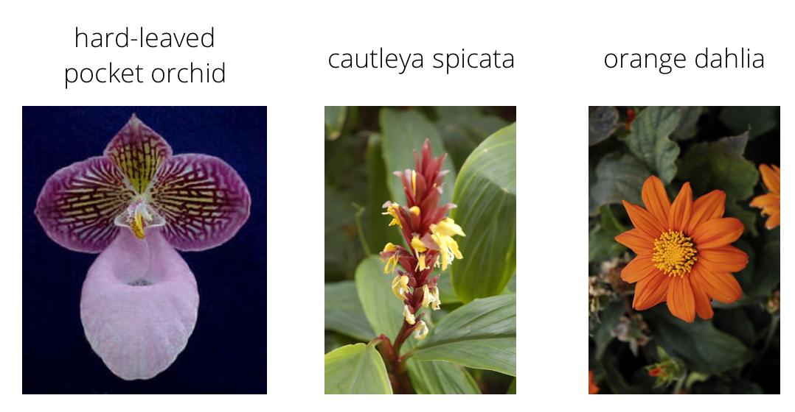
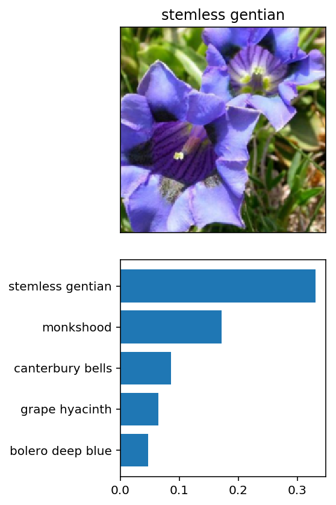

# Flower Image Classifier

A PyTorch transfer-learning classifier for the [Oxford 102 Flowers](https://www.robots.ox.ac.uk/~vgg/data/flowers/102/) dataset. It identifies 102 flower species from a photo, and ships with command-line tools to train a model and to classify new images.



## How it works

- **Transfer learning:** starts from an ImageNet-pretrained backbone (VGG16, DenseNet121 or ResNet50), freezes its feature layers, and trains only a new classifier head (Linear → ReLU → Dropout → Linear).
- **Augmentation:** random resized crops, horizontal flips and rotations for training. Resize and center-crop for validation, test and inference.
- **Training loop:** cross-entropy loss and Adam on the head parameters. Validation loss and accuracy are reported every epoch, and the held-out test set is scored at the end.
- **Checkpoints:** save the architecture, head size and class mapping alongside the weights, so `predict.py` can rebuild the model with no extra flags.
- **Device-agnostic:** runs on CUDA, Apple Silicon (MPS) or CPU.



## Usage

```bash
pip install -r requirements.txt
```

Download the dataset into `flowers/` with `train/`, `valid/` and `test/` subfolders, one folder per class.

**Train**

```bash
python train.py flowers --arch vgg16 --hidden_units 512 --epochs 5 --gpu
```

| Option | Default | |
| --- | --- | --- |
| `--arch` | `vgg16` | `vgg16`, `densenet121` or `resnet50` |
| `--hidden_units` | `512` | size of the classifier's hidden layer |
| `--learning_rate` | `0.001` | |
| `--epochs` | `5` | |
| `--save_path` | `checkpoint.pth` | |
| `--gpu` | off | use CUDA or MPS when available |

**Predict**

```bash
python predict.py flowers/test/1/image_06743.jpg checkpoint.pth --top_k 3 --gpu
```

```
 91.2%  pink primrose
  3.4%  hard-leaved pocket orchid
  1.1%  mexican aster
```

(Illustrative output: your probabilities depend on the trained checkpoint.)

## Tests

```bash
pytest
```

`test_pipeline.py` runs the whole pipeline on a tiny synthetic dataset on CPU in seconds, with no download needed. It trains, saves a checkpoint, reloads it, and checks the predictions map back to the right class names.

## Project structure

| File | |
| --- | --- |
| `model.py` | Model construction, transforms, checkpointing, inference |
| `train.py` | Data loading, training loop, evaluation, CLI |
| `predict.py` | Inference CLI |
| `cat_to_name.json` | Class ID → flower name mapping |
| `Image Classifier Project.ipynb` | Original exploration notebook |

## Background

Started as the final project of Udacity's *AI Programming with Python* Nanodegree (AWS AI/ML Scholarship, 2023). Rewritten in 2026 for current PyTorch and torchvision. The rewrite fixed several bugs in the original:
- predictions were mapped to the wrong class names;
- DenseNet's input size was wrong;
- `--hidden_units` was ignored;
- inference only worked on GPU.

It also added a test.
